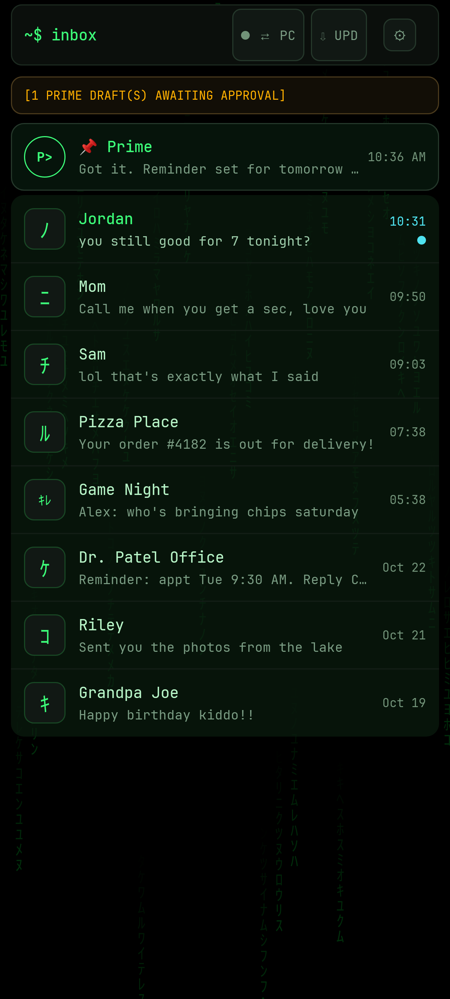
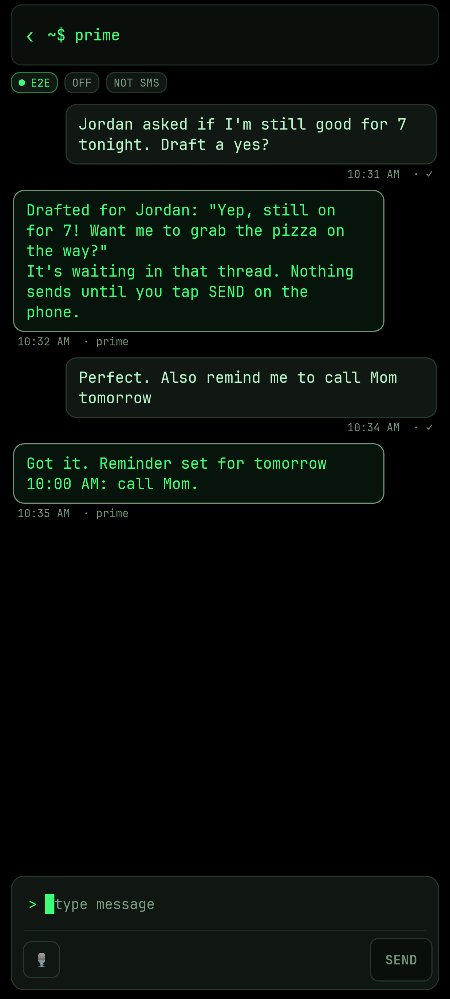
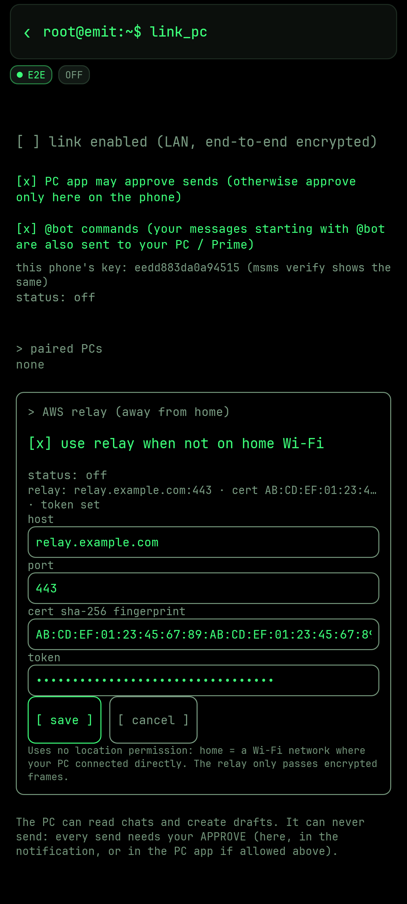

# Emit

## What it is
Emit is an Android SMS/MMS app with a Windows companion and an optional self-hosted relay. You can read and draft texts from your PC, or let an AI assistant draft them. Nothing is sent until you approve it on the phone.

<table>
<tr>
<td align="center"> Inbox with the pinned assistant chat</td>
<td align="center"> A conversation and the compose bar</td>
<td align="center"> Assistant chat (never over SMS)</td>
<td align="center"> Relay link setup</td>
</tr>
</table>

Screenshots use made-up contacts and placeholder relay details.

## Features
- SMS/MMS messaging, group chats, scheduling, quick reply, link previews, a custom keyboard, and voice-to-text
- Themes: Matrix (default), Neon City, ODST and Holiday, with optional theme sync with the Beacon launcher
- An assistant chat over the PC link (never goes over SMS)
- A PC companion (`msms`): a CLI, a local web UI, an MCP server for AI tools, and an `@bot` webhook bridge
- Over-the-link app updates. The phone checks the signer and version, then waits for you to tap install
- An optional relay so the link also works away from home Wi-Fi

## How it works (phone, relay, PC)
- **Phone (android/):** holds the messages and runs the link service. It only sends a message when you tap send or approve a draft.
- **PC (pc-companion/):** pairs with the phone over the LAN using a 6-digit SAS code, then calls RPCs to list threads, read them, create drafts and request sends.
- **Relay (relay/):** a TLS rendezvous that only splices ciphertext between the phone and the PC when they aren't on the same network.
See [docs/PROTOCOL.md](docs/PROTOCOL.md) and [docs/RELAY.md](docs/RELAY.md).

## Security design
- End-to-end X25519 key agreement with ChaCha20-Poly1305 framing. The relay never sees plaintext.
- Commit-then-reveal SAS pairing, which defeats a man-in-the-middle. Pairing only opens while the phone's pairing screen is open.
- Relay: TLS 1.3 only, a pinned self-signed certificate fingerprint, a shared token, rate limits and IP bans, and logs with trimmed IPs and 7-day retention. It runs as a hardened systemd unit.
- There is no direct-send RPC. `request_send` needs approval on an unlocked phone (least privilege for automation).
- Updates are verified by SHA-256, signing certificate and versionCode, and need a tap on the phone to install.

## Setup
### Android
Needs JDK 17 and the Android SDK. Run `cd android && ./gradlew assembleRelease`. For your own signing key, copy `keystore.properties.example` to `keystore.properties`.
### PC companion
Needs Python 3.12 and `cryptography`. Run `cd pc-companion/app && python -m msms --help`. `build_win.sh` builds a self-contained Windows zip. See [pc-companion/README.md](pc-companion/README.md).
### Relay
On a Linux server (Amazon Linux 2023 was tested), run `sudo bash relay/install.sh --public-host <your-server>`. It prints the certificate fingerprint, and the token is written to `/etc/msms-relay/client.json`.

## Configuration
See [config.example](config.example) and [relay/config.example.json](relay/config.example.json). Real configs, tokens, keys and keystores are gitignored and must never be committed.

## Testing
- Android: `cd android && ./gradlew testDebugUnitTest`
- PC: `cd pc-companion && python -m pytest tests` (`test_schemas` needs `jsonschema`)
- Relay: `cd relay && python -m pytest tests`

## Limitations
- Android only. The phone must be the default SMS app.
- The Windows companion is the main target. Other OSes work for the CLI and tests, but they lack DPAPI key wrapping.
- The relay uses a self-signed certificate with manual fingerprint pinning, with no CA or domain.
- It's a personal project with no security audit.

## License
Emit is licensed under **GPL-3.0-or-later**. See [LICENSE](LICENSE).
